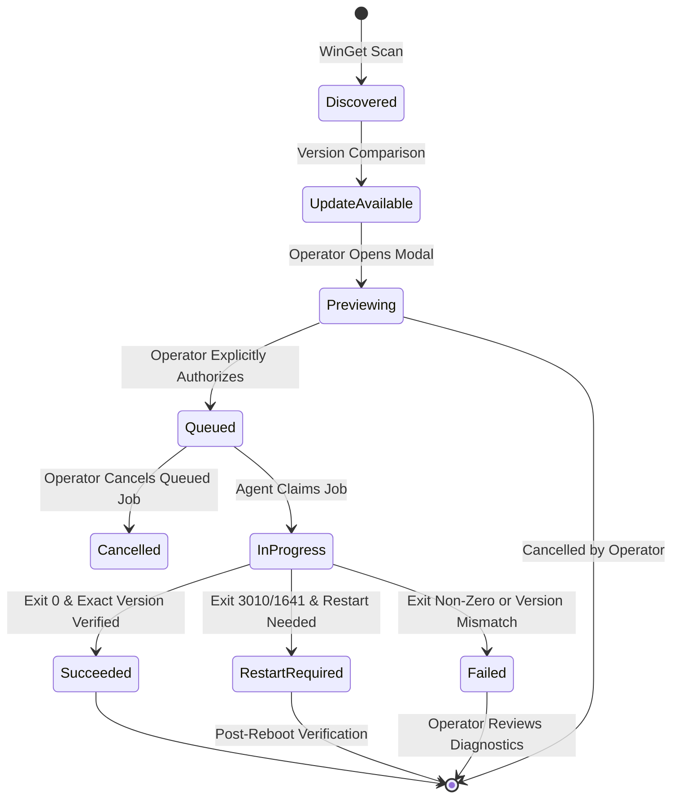

# UpdatePilot Security, Privacy & Safety Policy

This document outlines the security architecture, threat model, safe update workflows, privacy guarantees, and data retention policies for UpdatePilot.

---

## 1. Threat Model & Principles

Updates are privileged, system-changing operations. An insecure software updater introduces remote command execution (RCE) vectors and system compromise risks. UpdatePilot adheres to the following principles:

1. **Constrained Agent Interface**: The browser never receives arbitrary shell access or administrative command execution. All commands executed by the Windows agent are fixed, allowlisted operations.
2. **Mandatory Explicit Confirmation**: Updates are never executed silently or automatically by default. Every update requires explicit operator review and confirmation.
3. **Defense in Depth**:
   * Pre-execution validation: The agent independently validates that the requested package identifier and version match allowlisted regular expressions.
   * Version anchoring: The agent re-checks the currently installed version before executing an upgrade. If the local state changed in the interim, execution aborts.
   * Post-update independent verification: The agent independently queries `winget list` after installer completion to confirm that the package version actually matches the approved target before reporting success.
4. **Least Privilege**: The web dashboard runs under standard unprivileged user permissions. Administrative elevation is requested only by installers that explicitly require it.

---

## 2. Safe Update Workflow State Machine

---

## 3. Input Validation & Allowlist Specifications

All parameters transmitted from the web client or server to the agent are validated against strict Zod schemas:

| Field | Validation Pattern | Behavior on Invalid Input |
|---|---|---|
| `packageId` | `^[A-Za-z0-9][A-Za-z0-9._-]{0,127}$` | Immediate 400 rejection; agent rejects before spawn |
| `targetVersion` | `^[A-Za-z0-9][A-Za-z0-9._+~-]{0,127}$` | Immediate 400 rejection; agent rejects before spawn |
| `confirmedByUser` | `z.literal(true)` | Rejects if `false` or missing |
| `homepageUrl` / `changelogUrl` | Strictly HTTPS URI | Rejects `javascript:`, `file:`, or cleartext `http:` |

---

## 4. Authentication & Credential Protection

### Dashboard Operator
* Authenticated using a high-entropy secret (`DASHBOARD_PASSWORD`) verified using constant-time comparison (`timingSafeEqual`) to defeat timing side-channel attacks.
* Sessions are tracked via cryptographic, HTTP-only, `SameSite=Strict` cookies signed with HMAC-SHA256 (`SESSION_SECRET`).
* Anti-brute-force rate limiting: 8 consecutive failed login attempts trigger an exponential lock-out period.
* Mutation requests (`POST`, `PUT`, `DELETE`) require verification of the dashboard `Origin` header to mitigate cross-origin request forgery (CSRF).

### Windows Agent
* Agents pair via an authorized one-time or rotatable setup code (`AGENT_PAIRING_CODE`).
* Upon successful pairing, the server issues a 64-character random cryptographic bearer token (`up_tok_...`).
* The server stores only the SHA-256 hash of the bearer token in the database.
* Tokens can be revoked instantly from the dashboard Settings tab; once revoked, the agent cannot poll jobs, send heartbeats, or report scan results.

---

## 5. Privacy & Data Minimization

UpdatePilot collects only software inventory and operational telemetry needed to determine update status:

* **Collected Data**:
  * Machine display name and operating system build version.
  * Installed application names, publisher names, versions, and package IDs.
  * Scan and update execution exit codes, timestamps, and stdout/stderr logs.
* **Explicitly Excluded Data**:
  * UpdatePilot never inspects, accesses, or transmits personal documents, files, browsing history, user credentials, or private keys.
* **External Queries**:
  * Vulnerability queries to OSV send only the mapped upstream package name and version string (e.g. `github.com/cli/cli/v2`, `2.43.0`). No host identifiers or local IP addresses are transmitted.

---

## 6. Diagnostic Data Retention & Pruning

* Detailed installer stdout/stderr output and full JSON inventory snapshots are pruned after **30 days** by default (configurable via `DIAGNOSTIC_RETENTION_DAYS`).
* High-level immutable audit records (`AuditEvent`) are retained permanently for administrative accountability unless purged manually by the database administrator.

